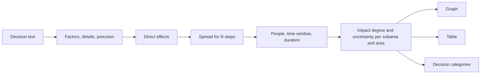

# impact map

See how one decision spreads to every area of life, regardless of distance, and how strong the
impact is in each area.

Write a decision in plain words, from two words to many sentences. Impact Map finds the decision
factors, computes the impact on 8 main areas and 36 subareas with one general equation, and
shows it as a fan-shaped graph and a table. The more detail you give, the narrower the
uncertainty range.

- **Decision model:** free text in Hungarian or English; recognised factors can be removed,
  added and weighted.
- **Impact map:** fan tree (collapsible, zoomable) and a grouped table, with direction, strength,
  uncertainty range, timing, evidence grade and main path for every subarea.
- **Scenario:** number of steps (1–7), number of people (1 – 1 000 000 000), time window, duration.
- **Decision categories:** derived from the result (domain, reach, horizon, magnitude, certainty).
- **Share:** save a decision model and open it with a link.

## Quick start

Requires Node 24 (`.nvmrc`). On macOS: `brew install node@24`. Behind a TLS-inspecting proxy
(for example Zscaler), run npm with `NODE_USE_SYSTEM_CA=1`, so Node trusts the system certificates.

```sh
npm ci
npm run dev          # API on :8080 and web on http://localhost:5173 (the UI)
npm run dev -w @impact-map/api   # API only, http://localhost:8080
npm test             # all unit tests (engine, API, web)
npm run build        # production bundle: apps/web/dist + apps/api/dist/server.js
npm run e2e          # Playwright against the production bundle (run build first)
npm run verify       # format, lint, typecheck, tests with coverage, build
docker compose up    # app + PostgreSQL on http://localhost:8080
```

`npm run e2e` uses the installed Microsoft Edge locally. Set `PW_BROWSER=chromium` to use the
Playwright Chromium (CI does this).

## Repository

| Path                                   | Content                                                            |
| -------------------------------------- | ------------------------------------------------------------------ |
| [packages/engine](packages/engine)     | Knowledge base, text interpretation, general equation, impact tree |
| [apps/web](apps/web)                   | React UI (zen design, D3 fan tree)                                 |
| [apps/api](apps/api)                   | Fastify API, static hosting, PostgreSQL store                      |
| [e2e](e2e)                             | Browser tests                                                      |
| [infra](infra)                         | Terraform for Azure (bootstrap, modules, dev, prod)                |
| [.github/workflows](.github/workflows) | CI, tests, SonarCloud, security scans, release, deploy             |
| [docs](docs)                           | Model, architecture, design, API, deployment, knowledge, ADRs      |

## How it works



The full equation, its parameters and its checks are in [docs/model.md](docs/model.md). With the
default scenario it gives the same numbers as the original Python prototype (285 reference cases,
within 1e-9).

## Documentation

- [Model: the general equation](docs/model.md)
- [Architecture](docs/architecture.md)
- [Design](docs/design.md)
- [API](docs/api.md)
- [Deployment on Azure](docs/deployment.md)
- [Knowledge base](docs/knowledge.md)
- Decisions: [0001 engine in the browser](docs/adr/0001-engine-in-the-browser.md),
  [0002 derived categories](docs/adr/0002-decision-categories-are-derived.md),
  [0003 Azure hosting](docs/adr/0003-azure-hosting.md),
  [0004 knowledge as code](docs/adr/0004-knowledge-as-code.md)

## Limits

Many weights are expert estimates, and factors do not interact. The result is guidance, not a
forecast. Every value is traceable to its evidence grade and sources.
