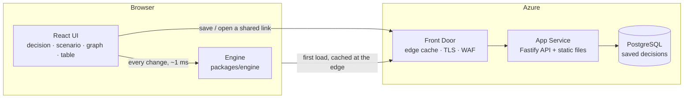

# Architecture

## Parts

| Part                                      | Role                                                                                                                                                                           |
| ----------------------------------------- | ------------------------------------------------------------------------------------------------------------------------------------------------------------------------------ |
| [packages/engine](../packages/engine)     | Pure TypeScript. Knowledge base (JSON), text interpretation, the general equation, impact tree, decision categories. No runtime dependencies. Runs in the browser and in Node. |
| [apps/web](../apps/web)                   | React 19 + Vite. Computes in the browser with the engine. D3 draws the fan tree.                                                                                               |
| [apps/api](../apps/api)                   | Fastify 5. Serves the web files, `/api/v1/*` (analyze, interpret, meta, saved decisions), health probes. Bundled into one self-contained file.                                 |
| [e2e](../e2e)                             | Playwright tests against the production bundle.                                                                                                                                |
| [infra](../infra)                         | Terraform for Azure: bootstrap (state, ACR, GitHub OIDC), modules, `dev` and `prod`.                                                                                           |
| [.github/workflows](../.github/workflows) | CI, tests, SonarCloud, security scans, release, deploy, infrastructure.                                                                                                        |

## Why it is fast

1. **The engine runs in the browser.** An analysis with the impact tree takes about 0.6 ms, so
   every key press and slider move updates the map without a network call
   ([ADR 0001](adr/0001-engine-in-the-browser.md)).
2. **Static files are cached at the edge.** The bundle is split into three long-lived chunks
   (app ≈ 23 kB, knowledge ≈ 57 kB, libraries ≈ 85 kB, gzip). Hashed assets are cached for a year.
3. **The API is small.** It is only needed to save and open shared decisions, and for API clients.

## Data

- The knowledge base is versioned JSON in the repository ([ADR 0004](adr/0004-knowledge-as-code.md)).
  The loader checks every reference at start and fails fast.
- PostgreSQL stores shared decision models: text, optional factor edits, scenario settings,
  model version. Rows are immutable; there are no user accounts yet.

## Security

- Public and anonymous at first. Strict CSP, HSTS, no inline scripts, rate limits on `/api/*`.
- The database has no public endpoint and accepts only Entra ID tokens (managed identity).
- The App Service accepts traffic only from this Front Door profile.
- GitHub Actions use OIDC; there are no long-lived cloud secrets.

## Tests

| Layer  | Tool                                                               | What                                                                               |
| ------ | ------------------------------------------------------------------ | ---------------------------------------------------------------------------------- |
| Engine | Vitest                                                             | Parity with the Python prototype, equation properties, parser, knowledge integrity |
| API    | Vitest + PGlite                                                    | Routes, validation, store (memory and PostgreSQL), headers, rate limit             |
| Web    | Vitest + jsdom                                                     | Components, graph rendering, state, formats                                        |
| E2E    | Playwright                                                         | Real browser against the production bundle                                         |
| Static | ESLint, TypeScript, Prettier, SonarCloud, CodeQL, Trivy, npm audit | Quality and security gates                                                         |
