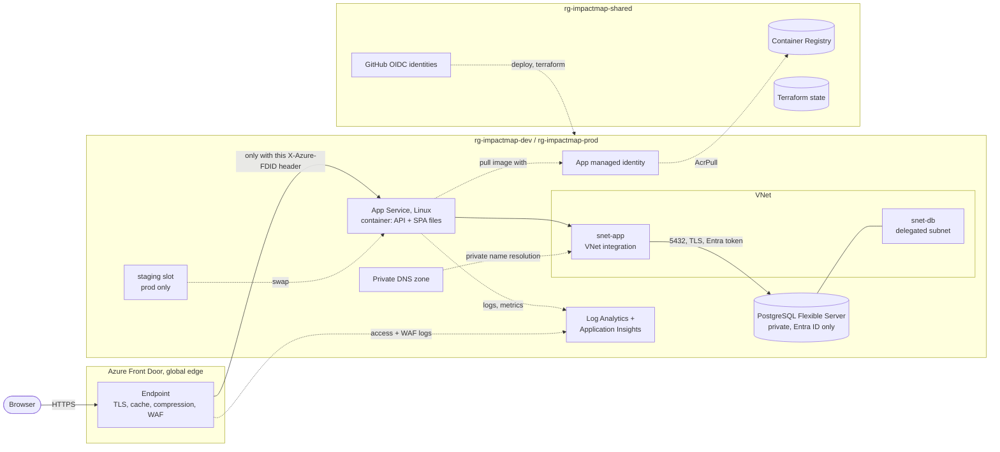
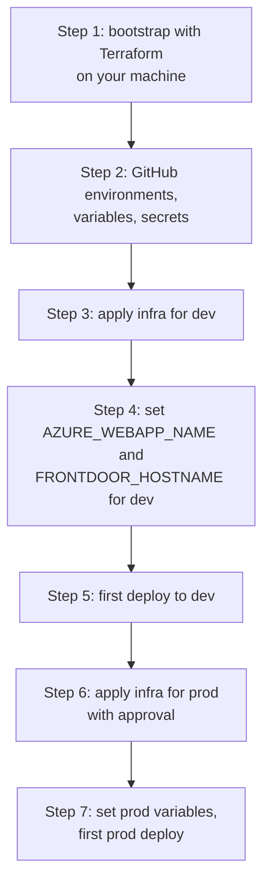
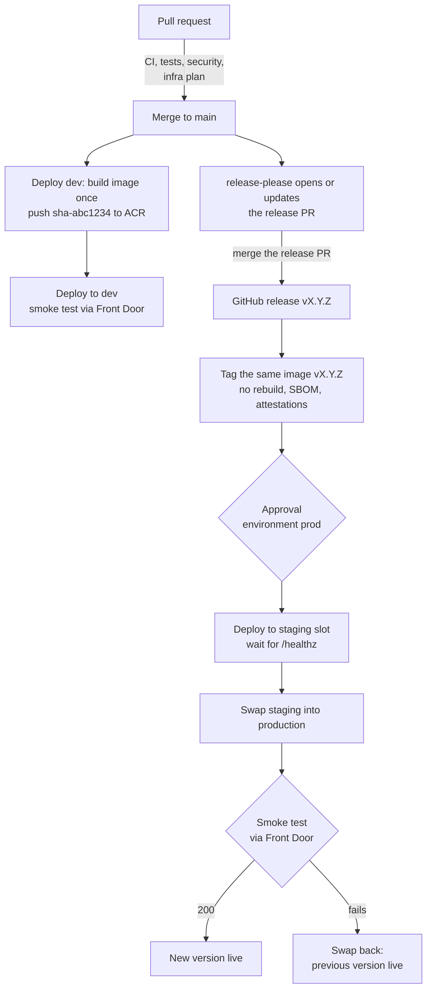

# Deployment on Azure

Impact Map runs in Azure in two environments, `dev` and `prod`. Terraform creates the
infrastructure ([infra](../infra)). GitHub Actions builds, tests, releases and deploys
([.github/workflows](../.github/workflows)). There are no cloud secrets: GitHub logs in to Azure
with OpenID Connect (OIDC), and the app logs in to PostgreSQL with a managed identity.

The decision and the alternatives are in [ADR 0003](adr/0003-azure-hosting.md).

## Architecture



| Part                         | What it does                                                                                                                                                                                        |
| ---------------------------- | --------------------------------------------------------------------------------------------------------------------------------------------------------------------------------------------------- |
| Azure Front Door             | Global entry point: TLS, HTTP/2, compression, edge cache, WAF. `/api/*`, `/healthz` and `/readyz` are never cached. Other paths follow the origin's `Cache-Control`.                                |
| App Service (Linux)          | Runs the image from ACR. Accepts requests only from this Front Door profile (service tag `AzureFrontDoor.Backend` + header `X-Azure-FDID`). HTTPS only, TLS 1.2+, FTP off, health check `/healthz`. |
| VNet integration             | All outbound traffic of the app goes through `snet-app` (`vnet_route_all_enabled`).                                                                                                                 |
| PostgreSQL Flexible Server   | In the delegated subnet `snet-db`, no public endpoint, name resolution through a private DNS zone. Entra ID authentication only (no passwords).                                                     |
| App managed identity         | One user-assigned identity per environment: `AcrPull` on the registry, Entra administrator of PostgreSQL, `AZURE_CLIENT_ID` of the app.                                                             |
| Container Registry (ACR)     | Shared by both environments. An image is built once and promoted to prod by digest. Admin user is off.                                                                                              |
| Log Analytics + App Insights | One per environment. Diagnostic settings send App Service HTTP/console/app logs, PostgreSQL logs and Front Door access/WAF logs.                                                                    |

## Why it is fast

1. **The engine runs in the browser.** An analysis takes about 1 ms, so the map follows every
   change without a network call ([ADR 0001](adr/0001-engine-in-the-browser.md)).
2. **Static files come from the edge.** Front Door caches the hashed files under `/assets/` for a
   year (`immutable`), close to every user. `index.html` uses `no-cache`, so a new release is
   visible at once.
3. **The API is small.** It is only needed to save and open shared decisions. API responses are
   never cached (`no-store`).
4. **Short paths.** HTTP/2 and TLS end at the nearest Front Door edge. Front Door keeps warm
   connections to the origin. The app is always on, and the database is in the same region and
   VNet as the app.

## Environments

| Setting                | dev                                 | prod                                                                              |
| ---------------------- | ----------------------------------- | --------------------------------------------------------------------------------- |
| Resource group         | `rg-impactmap-dev`                  | `rg-impactmap-prod`                                                               |
| Front Door             | Standard                            | Standard (lean start); Premium when you scale up                                  |
| WAF                    | Custom rules only, Detection mode   | Prevention, custom rules (Premium adds DefaultRuleSet 2.1, BotManagerRuleSet 1.1) |
| WAF rate limit `/api/` | 300 requests/min per IP (logged)    | 300 requests/min per IP (blocked)                                                 |
| App Service plan       | B1, 1 instance, no slots            | P0v3, 1 instance, slot `staging` (deploy to slot, then swap)                      |
| PostgreSQL             | Burstable `B_Standard_B1ms`, 32 GiB | Burstable `B_Standard_B2s`, 32 GiB                                                |
| PostgreSQL HA          | none                                | none (set `postgres_high_availability_enabled = true` to scale up)                |
| Backups (PITR)         | 7 days                              | 35 days, geo-redundant                                                            |
| Log retention          | 30 days, 1 GB/day cap               | 90 days, no cap                                                                   |
| Availability test      | `/healthz`, 3 locations, 15 min     | `/healthz`, 3 locations, 15 min                                                   |
| Deployment             | every push to `main`                | every release, after approval                                                     |

The values are the defaults in `infra/envs/<env>/variables.tf`. Optional per environment: e-mail
alerts (`alert_email`), a monthly budget (`budget_amount`) and a custom domain (`custom_domain`).

## Monthly cost (rough estimate)

These are **estimates only**: pay-as-you-go list prices in USD for West Europe in 2026, little
traffic. Prices change and depend on region, currency, traffic and agreements. Check the
[Azure pricing calculator](https://azure.microsoft.com/pricing/calculator/) before you decide.

| Item                                | dev          | prod (lean start, default) | prod (scaled up)                         |
| ----------------------------------- | ------------ | -------------------------- | ---------------------------------------- |
| Front Door (base fee + light usage) | ~ 35–45      | ~ 35–45 (Standard)         | ~ 330–360 (Premium includes managed WAF) |
| App Service plan                    | ~ 13 (B1)    | ~ 65 (1 × P0v3)            | ~ 230 (2 × P1v3; the slot is free)       |
| PostgreSQL (compute + storage)      | ~ 16         | ~ 35 (B2s, no HA)          | ~ 320 (D2ds_v5 + HA standby + storage)   |
| Backup storage                      | ~ 0          | ~ 3 (geo-redundant)        | ~ 5 (geo-redundant)                      |
| Log Analytics + App Insights        | ~ 0–15       | ~ 10–30                    | ~ 10–50                                  |
| Availability test                   | ~ 9          | ~ 9                        | ~ 45                                     |
| VNet, NSGs, private DNS zone        | ~ 1          | ~ 1                        | ~ 1                                      |
| **Total per environment**           | **~ 75–100** | **~ 160–190**              | **~ 950–1 050**                          |

Shared: Container Registry Basic ~ 5, Terraform state storage < 1.

Prod starts lean: the engine runs in the browser, so the API and the database carry little load.
Scale up with variables only (see `infra/envs/prod/terraform.tfvars.example`): Front Door Premium
for managed WAF rules, zone-redundant PostgreSQL HA, and a second App Service instance.
Reservations (1 or 3 years) lower App Service and PostgreSQL prices.

## GitHub settings

No Azure secrets are stored in GitHub. All IDs are **variables**.

### Repository variables

Settings → Secrets and variables → Actions → Variables.

| Name                      | Value                                                                           | Used by                  |
| ------------------------- | ------------------------------------------------------------------------------- | ------------------------ |
| `AZURE_TENANT_ID`         | bootstrap output `github_repository_variables`                                  | all Azure jobs           |
| `AZURE_SUBSCRIPTION_ID`   | bootstrap output `github_repository_variables`                                  | all Azure jobs           |
| `AZURE_PLAN_CLIENT_ID`    | bootstrap output (read-only plan identity)                                      | `infra.yml` plans on PRs |
| `ACR_NAME`                | bootstrap output                                                                | deploy, release, infra   |
| `TFSTATE_STORAGE_ACCOUNT` | bootstrap output                                                                | `infra.yml`              |
| `TFSTATE_CONTAINER`       | bootstrap output (`tfstate`)                                                    | `infra.yml`              |
| `TFVARS_DEV`              | optional JSON with extra Terraform inputs for dev                               | `infra.yml`              |
| `TFVARS_PROD`             | optional JSON with extra Terraform inputs for prod                              | `infra.yml`              |
| `SONAR_ORGANIZATION`      | SonarCloud organization key                                                     | `sonarcloud.yml`         |
| `SONAR_PROJECT_KEY`       | SonarCloud project key                                                          | `sonarcloud.yml`         |
| `ATTESTATIONS_ENABLED`    | optional `true`: attestations in a private repository (GitHub Enterprise Cloud) | `release.yml`            |

Example for `TFVARS_PROD` (no secrets in it):
`{"alert_email":"ops@example.com","budget_amount":1100,"custom_domain":"impact-map.example.com"}`

### Environment variables

Settings → Environments → `dev` / `prod` → Environment variables.

| Name                   | Value                                                 |
| ---------------------- | ----------------------------------------------------- |
| `AZURE_CLIENT_ID`      | bootstrap output `github_environment_variables.<env>` |
| `AZURE_RESOURCE_GROUP` | bootstrap output `github_environment_variables.<env>` |
| `AZURE_WEBAPP_NAME`    | env stack output `github_environment_variables`       |
| `FRONTDOOR_HOSTNAME`   | env stack output `github_environment_variables`       |

### Secrets

| Name                   | Kind              | Purpose                                                                                                                                              |
| ---------------------- | ----------------- | ---------------------------------------------------------------------------------------------------------------------------------------------------- |
| `SONAR_TOKEN`          | repository secret | SonarCloud analysis. Without it the job is skipped with a notice.                                                                                    |
| `RELEASE_PLEASE_TOKEN` | repository secret | Optional. Fine-grained PAT or GitHub App token. With it, CI also runs on the release PR (PRs created with the default token do not start workflows). |

### Environments and protection

| Environment | Deployment branches | Protection                                                                      |
| ----------- | ------------------- | ------------------------------------------------------------------------------- |
| `dev`       | `main` only         | none                                                                            |
| `prod`      | `main` only         | **Required reviewers** (at least one person), no self-review if you have a team |

Also protect `main`: pull requests only, and require the checks of `CI`, `Tests`, `Security` and
(for infra changes) `Infrastructure`.

## Workflows

| Workflow         | Trigger                                | What it does                                                                                                          |
| ---------------- | -------------------------------------- | --------------------------------------------------------------------------------------------------------------------- |
| `ci.yml`         | PR, push `main`                        | format check, lint, typecheck, build; Docker build (no push, GitHub cache) and a container smoke test                 |
| `test.yml`       | PR, push `main`                        | unit tests with coverage (lcov artifact); Playwright e2e in Chromium (report artifact on failure)                     |
| `sonarcloud.yml` | PR, push `main`                        | coverage + SonarCloud scan; skipped when `SONAR_TOKEN` is missing                                                     |
| `security.yml`   | PR, push `main`, weekly                | CodeQL (JS/TS, Actions), dependency review (PR, fails on high), `npm audit`, Trivy filesystem and image scans (SARIF) |
| `deploy-dev.yml` | push `main`, manual                    | builds the image once, pushes `sha-<short sha>` to ACR, deploys to dev                                                |
| `release.yml`    | push `main`                            | release-please; on a release: tag the same image `v<version>`, SBOM, attestations, deploy to prod                     |
| `_deploy.yml`    | called by the two above, manual        | dev: update the app; prod: staging slot → health check → swap → smoke test → swap back on failure                     |
| `infra.yml`      | PR / push `main` on `infra/**`, manual | fmt, validate, tflint, Trivy; PR: read-only plans for dev and prod; push: apply dev; manual: apply prod (approval)    |

Each image contains `/version.json` (version, commit, build time). The deploy job compares it
with the image's commit, so it knows that the new build is really live.

CodeQL, the SARIF upload of Trivy and dependency review need a public repository or, for a
private repository, GitHub Code Security.

## First-time setup



You need: an Azure subscription where you are **Owner** (bootstrap creates role assignments and
one custom role), Azure CLI, Terraform ≥ 1.9 (tested with 1.16.6), and admin rights on the GitHub
repository. `gh` (GitHub CLI) is optional.

### 1. Bootstrap (once, on your machine)

```bash
az login
az account set --subscription "<subscription id>"
export ARM_SUBSCRIPTION_ID="$(az account show --query id -o tsv)"

cd infra/bootstrap
cp terraform.tfvars.example terraform.tfvars   # set github_owner and github_repository
terraform init
terraform apply
terraform output github_repository_variables
terraform output github_environment_variables
terraform output gh_cli_commands               # ready-made "gh variable set" commands
```

Bootstrap creates the shared resource group, the state storage account, the container registry,
both environment resource groups, the GitHub OIDC identities with their roles, and it registers
the needed Azure resource providers. Role assignments can take a few minutes to become active.

Optional: move the bootstrap state into the storage account (see
[infra/README.md](../infra/README.md#bootstrap)).

### 2. GitHub

1. Create the environments `dev` and `prod` (Settings → Environments). Limit both to the `main`
   branch. Add **required reviewers** to `prod`.
2. Set the repository variables and the `AZURE_CLIENT_ID` / `AZURE_RESOURCE_GROUP` environment
   variables (run the `gh_cli_commands` output, or use the web UI).
3. Optional: `SONAR_TOKEN`, `SONAR_ORGANIZATION`, `SONAR_PROJECT_KEY`, `RELEASE_PLEASE_TOKEN`,
   `TFVARS_DEV`, `TFVARS_PROD`.

### 3. Infrastructure for dev

Push a change under `infra/` to `main`, or run **Infrastructure** manually with `dev`. Locally:

```bash
cd infra/envs/dev
terraform -chdir=../../bootstrap output -json backend_hcl | jq -r .dev > backend.hcl
cp terraform.tfvars.example terraform.tfvars   # set acr_name
terraform init -backend-config=backend.hcl
terraform apply
```

The first apply takes about 15–30 minutes (PostgreSQL and Front Door are the slow parts).

### 4. Variables from the dev stack

```bash
terraform output github_environment_variables
gh variable set AZURE_WEBAPP_NAME  --env dev --body "<value>"
gh variable set FRONTDOOR_HOSTNAME --env dev --body "<value>"
```

### 5. First deploy to dev

Run **Deploy dev** manually (or push to `main`). Until the first deploy the web app has no image
(`impact-map:bootstrap` does not exist), so it shows an error page. That is expected. Then open
`https://<FRONTDOOR_HOSTNAME>/healthz`. A new Front Door endpoint can need a few minutes before
it answers everywhere.

### 6. and 7. Production

1. Run **Infrastructure** manually with `prod` and approve it. Review the prod plan of the pull
   request first.
2. Set `AZURE_WEBAPP_NAME` and `FRONTDOOR_HOSTNAME` for `prod` from the prod stack outputs.
3. First prod deploy: merge the release PR that release-please opens (see below). Or run
   **Deploy** manually with `prod` and an existing tag, for example the `sha-…` tag that runs on dev.

### Custom domain (optional)

1. Put `custom_domain` into `TFVARS_<ENV>` (or `terraform.tfvars`) and apply.
2. Create a TXT record `_dnsauth.<domain>` with the output `custom_domain_validation_token`.
3. Create a CNAME record `<domain>` → output `custom_domain_cname_target`.
4. Front Door validates the domain and issues a managed certificate (can take up to an hour).

## Release flow

Commits follow [Conventional Commits](https://www.conventionalcommits.org/) (`feat:`, `fix:`,
…). release-please uses them for the version number and `CHANGELOG.md`.



## Rollback

| Situation                                  | What to do                                                                                                                                                             |
| ------------------------------------------ | ---------------------------------------------------------------------------------------------------------------------------------------------------------------------- |
| Prod smoke test fails after the swap       | Nothing: the deploy job swaps back automatically.                                                                                                                      |
| Problem found shortly after a prod release | Swap again. The `staging` slot still runs the previous version: `az webapp deployment slot swap -g rg-impactmap-prod -n <app> --slot staging --target-slot production` |
| Any older version                          | Run **Deploy** manually: environment `prod`, image tag `v<older version>` (or `sha-…`). It uses the normal slot, health check and swap path.                           |
| Bad infrastructure change                  | Revert the pull request. The revert applies to dev on merge; run **Infrastructure** for prod.                                                                          |

Database schema changes must stay backward compatible for one release, because the slot and
production share the database during a swap and a rollback.

## Database backup and restore

Azure backs up the server automatically (full snapshots plus transaction logs). You can restore
to any point in time inside the retention window: 7 days in dev, 35 days in prod. Prod backups
are also geo-redundant.

A restore always creates a **new** server:

```bash
az postgres flexible-server restore \
  --resource-group rg-impactmap-prod \
  --name psql-impactmap-prod-restored \
  --source-server <psql server name> \
  --restore-time "2026-10-21T08:30:00Z"
```

Then:

1. Check the data on the new server (it is private: use a VM, Cloud Shell in the VNet, or a
   temporary access path).
2. Make sure the app identity is the Entra administrator of the new server
   (`az postgres flexible-server microsoft-entra-admin list`).
3. Either copy the needed rows back into the original server (`pg_dump` / `pg_restore`), or point
   the app to the new server (`PGHOST`) and bring Terraform in line (`terraform import` or
   `terraform state` commands) before the next apply.

Region outage (prod): `az postgres flexible-server geo-restore` creates a server from the
geo-redundant backup in the paired region.

## Security notes

- **WAF**: prod blocks the OWASP-based Default Rule Set 2.1 (anomaly scoring), bad bots and
  `/api/` floods. Dev runs the same custom rules in Detection mode (log only).
- **Private database**: no public endpoint, delegated subnet, private DNS. TLS is required.
- **Entra ID only for PostgreSQL**: no passwords exist. The app gets a short-lived token with its
  managed identity.
- **Locked-down origin**: the App Service only accepts requests from this environment's Front
  Door profile. Kudu/SCM access is denied; deployments use the Azure Resource Manager API.
- **OIDC for GitHub**: no client secrets. Each environment has its own identity. The identities
  live in the shared resource group, so they cannot change their own federated credentials.
- **Least privilege for CI**: deployment identities have Contributor on their own resource
  group only. They may create role assignments, but an ABAC condition allows only `AcrPull` and
  `Monitoring Metrics Publisher` for service principals. Pull request plans use a read-only
  identity without state lock.
- **State**: Entra ID access only (shared keys off), TLS 1.2, versioning, soft delete, delete lock.
- **Supply chain**: images are built once and promoted by digest. Releases get an SPDX SBOM and
  a signed build provenance attestation. Trivy, CodeQL, dependency review and `npm audit` run on
  every pull request and weekly.
- **No secrets in files**: all IDs are variables; `.trivyignore` lists accepted findings with a
  reason.

## Next hardening steps

1. **Least-privilege database roles**: today the app identity is the Entra administrator (it
   creates its tables at start). Next: a separate migration role, and an app role with only the
   rights it needs on its own schema.
2. `PGSSLMODE=verify-full` (certificate and host name check).
3. Front Door Premium **Private Link** to the App Service and a private endpoint on the app, so the
   origin has no public endpoint at all.
4. **ACR Premium** with a private endpoint, `vnet_image_pull_enabled`, no public access; lock
   release tags (`az acr repository update --write-enabled false`); purge old `sha-` tags.
5. **Terraform state** behind a private endpoint with self-hosted runners (removes the accepted
   Trivy finding `AZU-0012`).
6. Resource locks on the prod resource group and database (needs an Owner).
7. Microsoft Defender for Cloud plans for App Service, databases and container registries.
8. Pin all third-party GitHub Actions by commit SHA (Dependabot keeps them current) and customize
   the OIDC subject claim to include the repository ID.
9. Application Insights with Entra ID authentication only (the ABAC condition already allows
   `Monitoring Metrics Publisher`).
10. A NAT gateway if a fixed outbound IP address is needed; App Service zone redundancy in prod
    (`app_service_zone_balancing_enabled`) where the region supports it.
